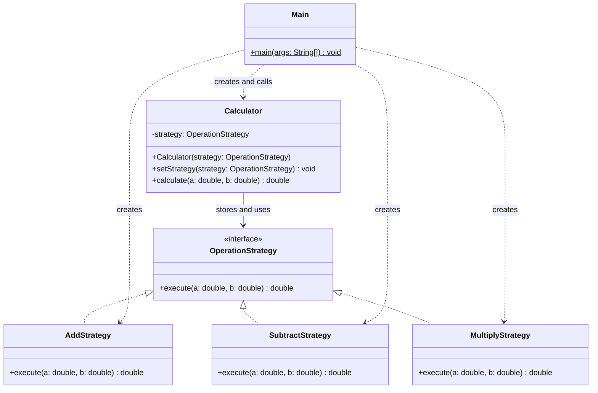

# Assignment 5 — Strategy Pattern

**Course:** Software Design Patterns  
**Student:** Dauletkyzy Bayan SE-2523

## 1. Introduction

I chose Option B, a calculator, and used Java 17. My program has three interchangeable algorithms: addition, subtraction and multiplication. Each algorithm implements the same interface. In Main, I change the strategy of one Calculator object during a single run.

## 2. UML class diagram



Calculator is the Context. OperationStrategy is the Strategy interface. The three operation classes are Concrete Strategies. Main is the Client that selects them.

## 3. Clean Code principles

### 3.1 Polymorphism instead of conditional logic

```java
return strategy.execute(a, b);
```

In Calculator, I delegate the calculation to the selected strategy. There is no if or switch checking the operation type. The actual strategy object determines which execute method runs.

### 3.2 Meaningful names

```java
calculator.setStrategy(new SubtractStrategy());
```

SubtractStrategy describes the operation, and setStrategy describes the change. These names explain the purpose of the statement.

### 3.3 Single responsibility

```java
public double execute(double a, double b) {
    return a + b;
}
```

This method in AddStrategy only returns the sum. It does not print results or select another operation. I keep console output and the demonstration in Main.

### 3.4 Context independent of concrete algorithms

```java
private OperationStrategy strategy;
```

I use the interface as the field type. Calculator does not need to know the internal code of AddStrategy, SubtractStrategy or MultiplyStrategy. They can all be used through the same interface.

### 3.5 Extensibility

```java
public void setStrategy(OperationStrategy strategy) {
    this.strategy = Objects.requireNonNull(
            strategy, "Strategy must not be null"
    );
}
```

The setter accepts any implementation of OperationStrategy. To add division, I would create a new class implementing execute and select it in Main. Calculator, the interface and the existing strategies would stay unchanged. Division is a possible extension; it is not implemented in the current project.

## 4. Strategy vs. State

Strategy changes the algorithm used for a task. State changes an object's behaviour according to its internal state and transitions. My calculator needs different mathematical algorithms selected by the client, so Strategy fits the problem. The strategies do not control state transitions or select each other.

## 5. Conclusion

I demonstrated three operations using one calculator and changed its strategy at runtime. I compiled and ran the project with JDK 17.0.18. The results were correct: 10 + 5 = 15, 10 - 5 = 5, 10 * 5 = 50, -4 + 2 = -2, 2.5 - 0.5 = 2 and 7 * 0 = 0.

The pattern adds classes, but it keeps each operation separate and makes new algorithms easier to add without changing Calculator.

**Sources and assistance:** Assignment 5 Strategy Pattern brief, 2026–2027; OpenAI ChatGPT, this assignment conversation, for explanations and code examples. The report was prepared with ChatGPT assistance and needs my review before submission under the course rules.

## 6. GitHub repository

**TO BE ADDED:** paste the actual GitHub repository URL here before submission.
